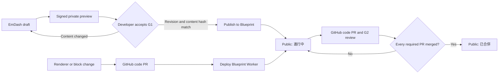

Blueprint presents current capability knowledge, the Design System and published Change pages. Git owns the renderer, block schemas, tests and workflow code. EmDash owns Change articles and their publication lifecycle. Authors and Agents write Portable Text and versioned Blueprint typed blocks directly through EmDash MCP.

## Change lifecycle

## Current behavior

- Each Change is one EmDash entry at `/changes/<slug>`. Its versioned declarative blocks are rendered through an allowlisted registry of existing Astro components. EmDash content cannot execute TSX, JavaScript, MDX imports or arbitrary component names.
- Before G1, a draft is visible only through EmDash's signed, private preview at the same Blueprint route. The Linear execution issue records the accepted revision and SHA-256 of its content. The publish policy reads that evidence and blocks publication if the saved content no longer matches.
- Publishing after G1 makes a new Change public as **進行中**. G2 reviews its code on GitHub and does not republish the article. Once every required PR is merged, the page becomes **已合併** using the last required PR's `merged_at`. There is no public “discussion” state or G1/G2 badge. New, pre-G1 Changes remain private.
- Required PR URLs are an index. GitHub supplies commits, files changed, additions, deletions and `src` file counts; structured scenario blocks supply the scenario count. The page does not store manual status, merge dates, metrics or a copy of `facts.json`.
- Unmerged PR data is cached for at most five minutes. Merged results are cached by merge commit SHA. If GitHub is unavailable, a still-valid cache may be shown; with no verified result, the page remains **進行中** and omits PR metrics. Articles sort by `mergedAt ?? publishedAt`, newest first.
- EmDash content publication changes the page on the next request without a Git build or deployment. Changes to renderers, schemas, Features or the Design System go through code PRs and deploy the Blueprint Worker. The VolleyBro app stays on Vercel.
- Cloudflare use is limited to Free quotas: Workers Free, D1 Free and R2 Standard's included allowance. No Workers Paid plan or paid overage is enabled. R2 uploads stop at the implementation's conservative 8 GB storage and 100,000 monthly upload-request caps; a failed or unverifiable quota check blocks uploads. Recheck account-wide usage and the current limits before activation. If the Free limits cannot serve the workload, stop for a developer decision.
- The legacy `blueprint-changes` snapshot contains 45 pages. Convert it completely on the local machine and import it into an isolated EmDash environment. Every page must pass read-back, semantic and visual review, with archive and rollback evidence, before G2. Preserve page trees, proposal/review history, shard details, anchors, links, media bytes and alt text, and include only the latest effective accepted G1 specification for each matching Change. Formal production import reuses the same verified artifact without reconversion; environment-specific media references may be rebound and verified. `record-flows` and `sync-recording` remain public historical pages marked **進行中**, with no invented PRs or PR-derived metrics; that migration exception does not accept or implement either Change.
- A protected archive tag preserves every commit reachable from the fixed legacy snapshot. Older commits already unreachable at that snapshot are not guaranteed. The store branch remains until migrated pages, media, PR mappings, read-back, tag and rollback evidence pass; deleting the remote branch is a later authorized retirement action.
- Features and Design System pages remain repository content and continue to describe implemented capability and reusable UI rules. Do not place operational state or a duplicate Change specification in them.

## Constraints

- Code and tests define runtime behavior. EmDash defines accepted Change specifications and public article content; Linear holds operational status and the accepted revision/hash; GitHub PRs prove G2 and provide merge status and metrics.
- Portable Text and allowlisted, versioned typed blocks are the only content path. Reject raw HTML and executable content; retain no Markdown converter, Markdown/Rich Text renderer, legacy runtime block or sanitizer. Never evaluate legacy `design.tsx` files during migration. Keep one-time conversion/import tools until production import, read-back, cutover and rollback evidence are accepted, then remove them. Production activation is separately approved after G2.
- Derivable values are not manually duplicated. A missing or unavailable source must not be replaced by a guess.
- Decision records remain flat, repository-wide files at `blueprint/content/decisions/NNNN-<slug>.json`, with one schema definition. A record is adopted when written and is never copied, promoted or renumbered.
- Blueprint Change prose uses zh-TW with English technical terms. Feature and Design System prose, scenario strings, decision records and agent-facing documents use English.

## Implemented decisions

<DecisionTimeline />
