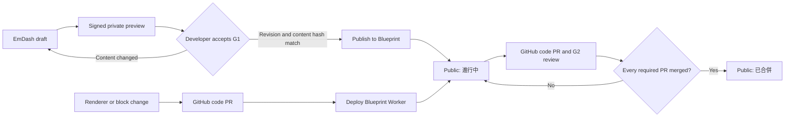

Blueprint presents current capability knowledge, the Design System and published Change pages. Git owns the renderer, block schemas, tests and workflow code. EmDash owns Change articles and their publication lifecycle. Authors and Agents write Portable Text and Blueprint typed blocks directly through EmDash MCP.

## Change lifecycle

## Current behavior

- Each Change is one EmDash entry at `/changes/<slug>`. Its declarative blocks are rendered through an allowlisted registry of existing Astro components. EmDash content cannot execute TSX, JavaScript, MDX imports or arbitrary component names.
- Code blocks and annotated diffs are syntax-highlighted with Shiki during the build, following the light or dark theme. Code is set in Sarasa Mono TC. A proposal's path or flow comparison stays interactive as a `step_walkthrough`; a static UI design may be a screenshot.
- Before G1, a draft is visible only through EmDash's signed, private preview at the same Blueprint route. The Linear execution issue records the accepted revision and SHA-256 of its content. The publish policy reads that evidence and blocks publication if the saved content no longer matches.
- Publishing after G1 makes a new Change public as **進行中**. G2 reviews its code on GitHub and does not republish the article. Once every required PR is merged, the page becomes **已合併** using the last required PR's `merged_at`. There is no public “discussion” state or G1/G2 badge. New, pre-G1 Changes remain private.
- Required PR URLs are an index. GitHub supplies commits, files changed, additions, deletions and `src` file counts; structured scenario blocks supply the scenario count. The page does not store manual status, merge dates or metrics.
- Unmerged PR data is cached for at most five minutes. Merged results are cached by merge commit SHA. If GitHub is unavailable, a still-valid cache may be shown; with no verified result, the page remains **進行中** and omits PR metrics. Articles sort by `mergedAt ?? publishedAt`, newest first.
- EmDash content events request an automated full SSG build without a Git content commit. The official Portable Text renderer and Blueprint components produce revision-bound public/private HTML in a dedicated private R2 bucket. Requests verify current lifecycle metadata and stream the matching artifact; they do not render article bodies. Until a new artifact is ready, its page returns a retryable unavailable response. Client islands retain their interactions. PR status and navigation refresh from a compact summary API without rebuilding HTML. The VolleyBro app stays on Vercel.
- Scenario counts are computed during content builds and bound to the rendered revision. Runtime lists and search read metadata; page requests select lifecycle fields by indexed slug. They do not expand article JSON or scan revision history. GitHub cache reads use indexed keys in batches. Content builds read current live and draft bodies, with a conservative D1 read budget.
- Cloudflare use is limited to Free quotas: Workers Free, D1 Free and R2 Standard's included allowance. No Workers Paid plan or paid overage is enabled. Media uploads are capped at 20 MiB per file; media and private page artifacts have no in-repo usage ledger because real usage is far below the R2 Free allowance, and an account billing alert is the backstop. Recheck account-wide usage and the current limits before activation. If the Free limits cannot serve the workload, stop for a developer decision.
- Features and Design System pages remain repository content and continue to describe implemented capability and reusable UI rules. Do not place operational state or a duplicate Change specification in them.

## Constraints

- Code and tests define runtime behavior. EmDash defines public Change-page content, written only on demand; Linear holds the working spec and operational status; GitHub PRs prove G2 and provide merge status and metrics.
- Portable Text and allowlisted typed blocks are the only content path. Reject raw HTML and executable content. Represent proposal interactions as typed data; static UI designs may use developer-approved screenshots.
- `diagram` v1 stores SVG geometry, positioned text, source IDs and markers as typed data; labels are escaped, with no raw SVG, CSS, script or URL paint.
- Interactive flowcharts use Mermaid source, node-ID details and optional named paths through Pele. Node selection and path exploration stay interactive; empty detail panels are omitted. Authors cannot supply raw HTML, rendering options, custom CSS or network links. Layout is derived rather than stored as coordinates.
- Derivable values are not manually duplicated. A missing or unavailable source must not be replaced by a guess.
- Decision records remain flat, repository-wide files at `blueprint/content/decisions/NNNN-<slug>.json`, with one schema definition. A record is adopted when written and is never copied, promoted or renumbered.
- Blueprint Change prose uses zh-TW with English technical terms. Feature and Design System prose, scenario strings, decision records and agent-facing documents use English.

## Implemented decisions

<DecisionTimeline />
